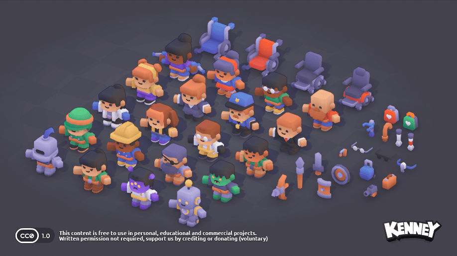

# Kralnu Assets

Shared art and audio for **Kralnu Games** projects.

Only assets that are free for commercial use go in here: **CC0** (no credit needed) or **CC-BY** (credit needed). The licence file for each pack stays inside its folder. Every pack is listed in [CREDITS.md](CREDITS.md).

## How it's used

Games don't link to this repo directly. When a game needs an asset, copy just the files it uses into that game's own repo, keeping the folder structure, so a game never breaks if something here is moved or renamed.

## Packs

| Pack | Folder | Type | Licence |
|---|---|---|---|
| Kenney – Mini Characters 2.0 | [`kenney/mini-characters`](kenney/mini-characters) | Low-poly 3D, animated | CC0 |

### Kenney – Mini Characters 2.0

- **25 characters** (male a–g, female a–f, knight, soldier, raider, worker, robot, alien, zombie, and more) plus weapons, shields, luggage, mobility aids and wheelchairs. There are 43 models in total.
- **Formats:** `glb/` (best for web games, e.g. three.js), `fbx/` and `obj/`. Each format folder has its own `Textures/colormap.png`, which the models need, so keep it next to them.
- **Animations built into every character:** idle, walk, sprint, jump, fall, crouch, sit, drive, die, pick-up, emote yes/no, holding (left/right/both, with shoot variants), melee attack left/right, kick left/right, interact left/right, and wheelchair moves.
- `previews/` has a PNG render of each model.
